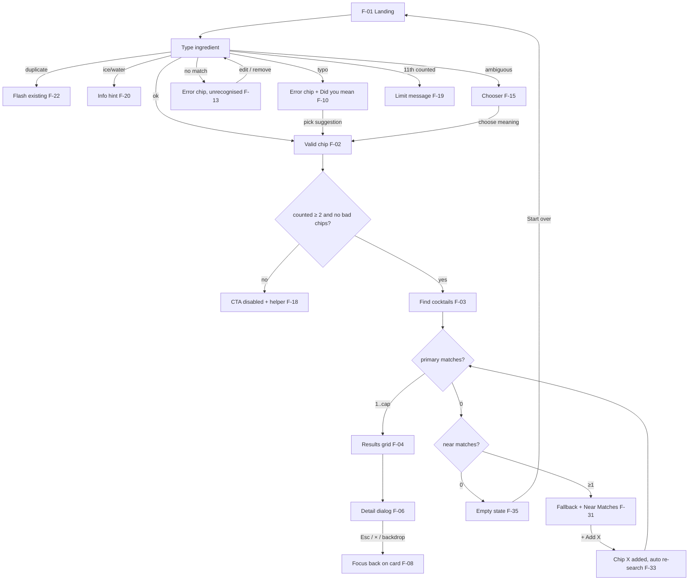

# Screen Flows — Cocktail Discovery MVP

Owner: UX/UI Designer · v1.0 · 2026-10-21
Specs: [components.md](components.md) · Copy: [copy.md](copy.md) · A11y: [a11y-responsive.md](a11y-responsive.md)

Each frame has an ID (`F-xx`) that QA can reference. Story IDs come from [docs/ba/user-stories.md](../docs/ba/user-stories.md). Examples use real library data (seed of 50) where possible.

## Coverage matrix

| Flow | Frames | Stories |
|---|---|---|
| A. Happy path | F-01 → F-08 | US-E1-01, 02, 03, US-E2-01, US-E3-01/02/04/05, US-E4-01 to 05, US-E5-01 to 03, US-NF-02 |
| B. Typo → suggestion | F-10 → F-12 | US-E2-02, US-E2-05 |
| C. Unparseable → edit/remove | F-13 → F-14 | US-E2-04, US-E2-05 |
| D. Ambiguous → choose | F-15 → F-17 | US-E2-03, US-E2-05 |
| E. Fewer than 2 | F-18 | US-E1-03 |
| F. More than 10 | F-19 | US-E1-04 |
| G. Water/ice only and mixed | F-20 → F-21 | US-E1-05, US-E1-06 |
| H. Duplicate | F-22 | US-E1-07 |
| I. Zero match → near → + Add → results | F-30 → F-34 | US-E6-01 to 04, US-E3-03, US-E3-07 |
| J. Nothing at all | F-35 | US-E6-05 |
| K. Share link / reload | F-40 | US-NF-04 |



---

## A. Happy path: land → chips → search → results → detail → close

### F-01 Landing (US-E1-01)

Mobile 360:
```
┌────────────────────────────┐
│ ❄ Cocktail Cabinet     ◐   │ header (theme toggle)
│                            │
│ What’s in your cabinet?    │ H1 (--text-3xl)
│ Tell us what’s in your     │
│ cabinet. We’ll tell you…   │
│                            │
│ Your ingredients  0 / 10   │
│ ┌────────────────────────┐ │
│ │ Type an ingredient, e.g│ │ glass field, 48px
│ └────────────────────────┘ │
│ Press Enter or comma to…   │ helper
│                            │
│ ┌────────────────────────┐ │
│ │   🔍 Find cocktails    │ │ CTA aria-disabled
│ └────────────────────────┘ │
│ Add at least 2 ingredients │ hint.min
│ ── how it works ────────── │
│ ① Add  ② Search  ③ Pour    │
└────────────────────────────┘
```

Desktop 1440:
```
┌──────────────────────────────────────────────────────────────────────────────┐
│ ❄ Cocktail Cabinet                                                       ◐   │
│                                                                              │
│                      What’s in your cabinet?                                 │
│        Tell us what’s in your cabinet. We’ll tell you what to pour.          │
│                                                                              │
│          Your ingredients                              0 / 10 ingredients    │
│          ┌──────────────────────────────────────────────────────────────┐    │
│          │ Type an ingredient, e.g. gin, lime, mint                     │    │ 720px max
│          └──────────────────────────────────────────────────────────────┘    │
│          Press Enter or comma to add…           [ 🔍 Find cocktails ]        │
│                                          Add at least 2 ingredients to search│
│            ① Add what you have   ② Find cocktails   ③ Open a recipe          │
└──────────────────────────────────────────────────────────────────────────────┘
```

Focus starts on the page, and the first Tab lands on the skip link, then the input. Autofocusing the input is **desktop only** (≥ 1024), so the mobile keyboard doesn't pop up on load.

### F-02 Typing & committing chips (US-E1-01, US-E2-01)

```
Your ingredients                                 3 / 10 ingredients  Clear all
┌──────────────────────────────────────────────────────────────┐
│ [● Gin ×] [● Campari ×] [● Sweet Vermouth ×]  verm▌          │
└──────────────────────────────────────────────────────────────┘
  ┌───────────────────────────────────┐
  │▌● Sweet Vermouth  vermouth · added│ (aria-disabled)
  │ ● Dry Vermouth    vermouth        │ ← active descendant
  └───────────────────────────────────┘
```

- Typing "verm" opens the listbox (2 options). "Fresh lemon" shows "Fresh lemon → Lemon Juice".
- Enter, comma, or a click on an option commits. The input clears and the counter updates (polite SR).
- "gin, campari" pasted creates 2 chips.

### F-03 Ready to search (US-E1-03)

The CTA is enabled (lime with dark ink) and the helper is hidden. Enter in an empty input, or activating the CTA, submits.

### F-04 Results (US-E4-01, 03, 04, 05)

Input: Gin, Campari, Sweet Vermouth gives 1 primary match (Negroni). Near Matches are **not** shown (US-E4-04).

Desktop 1440 (1 result, feature card):
```
          Your ingredients                              3 / 10 ingredients
          [● Gin ×] [● Campari ×] [● Sweet Vermouth ×]  Add another…
                                                     [ 🔍 Find cocktails ]
 ─────────────────────────────────────────────────────────────────────────
                Your cocktails
                1 cocktail you can make right now
                Just one — but it’s a good one.
             ┌──────────────────────────────────────────────┐
             │ VINTAGE · 1919                 🥃 Old Fashioned│
             │ Negroni                  [✓Gin][✓Campari]    │
             │ Bold, bittersweet and    [✓Sweet Vermouth]   │
             │ aromatic.                Uses 3 of yours  →  │
             └──────────────────────────────────────────────┘
```

Desktop, 6 results (e.g. 4 ingredients, capped):
```
 Your cocktails
 6 cocktails you can make right now · Showing the top 6 of 9 matches.
 ┌────────┐ ┌────────┐ ┌────────┐
 │ card 1 │ │ card 2 │ │ card 3 │
 └────────┘ └────────┘ └────────┘
 ┌────────┐ ┌────────┐ ┌────────┐
 │ card 4 │ │ card 5 │ │ card 6 │
 └────────┘ └────────┘ └────────┘
```

Mobile 360 (1 column, sticky CTA):
```
┌────────────────────────────┐
│ [Gin×][Campari×][Sweet V×] │
│ Your cocktails             │ ← focus lands here (H2)
│ 1 cocktail you can make…   │
│ ┌────────────────────────┐ │
│ │ VINTAGE · 1919      🥃 │ │
│ │ Negroni                │ │
│ │ Bold, bittersweet and  │ │
│ │ aromatic.              │ │
│ │ [✓Gin][✓Campari]       │ │
│ │ [✓Sweet Vermouth]      │ │
│ │ Uses 3 of yours  View →│ │
│ └────────────────────────┘ │
│▓▓▓▓▓▓ Update results ▓▓▓▓▓▓│ sticky glass bar (only if chips changed)
└────────────────────────────┘
```

After search, focus moves to "Your cocktails" and the live region says "1 cocktail found" (US-E4-05). The URL updates to `?i=gin,campari,sweet-vermouth` (US-NF-04).

### F-05 Card hover/focus

The card lifts by 2px with shadow-2 and the arrow nudges. Keyboard: Tab moves card to card, and Enter/Space opens it.

### F-06 Detail dialog (US-E5-01, US-E3-05, US-NF-05)

Desktop: centred modal, 720px max. Mobile: full-screen sheet.
```
Mobile 360                              Desktop 1440 (modal over scrim)
┌────────────────────────────┐          ┌──────────────────────────────────────────┐
│ VINTAGE · 1919 · Built  [×]│ glass    │ VINTAGE · 1919 · Built in the glass   [×]│
│ Negroni                    │ header   │ Negroni                                  │
├────────────────────────────┤          ├──────────────────────────────────────────┤
│ Ingredients                │          │ Ingredients           Servings [–] 1 [+] │
│ Servings   [–]  1  [+]     │          │ ✓  30 ml  Gin                            │
│ ✓ 30 ml  Gin               │          │ ✓  30 ml  Campari                        │
│ ✓ 30 ml  Campari           │          │ ✓  30 ml  Sweet Vermouth  sweet red verm.│
│ ✓ 30 ml  Sweet Vermouth    │          │ Glass Old Fashioned  Garnish Half orange │
│   sweet red vermouth       │          │ Method  1. Pour all ingredients…  2. Stir│
│ Glass    Old Fashioned     │          │ How it tastes   Bold, bittersweet and …  │
│ Garnish  Half orange slice │          │ The story       ¶ The usual story… ¶ …   │
│ Method                     │          │ Sources  IBA: Negroni ↗  Difford’s… ↗    │
│ ① Pour all ingredients…    │          └──────────────────────────────────────────┘
│ ② Stir gently.             │
│ How it tastes …            │
│ The story …                │
│ Sources …                  │
└────────────────────────────┘
```

Focus goes to the H2 "Negroni" and is trapped in the dialog. Background is inert.

### F-07 Servings scaling (US-E5-02)

Pressing [+] goes 1 → 2: 30 ml becomes 60 ml, "Top up" stays "Top up", and "2 dash" becomes "4 dashes". The SR hears "Amounts updated for 2 servings". [+] is disabled at 4 and [–] at 1.

### F-08 Close (US-E5-03)

Esc, ×, or a backdrop click closes the dialog. Focus returns to the Negroni card, and the chips and results are unchanged.

---

## B. Typo → "Did you mean…" (US-E2-02, US-E2-05)

### F-10 Error chip

```
Mobile 360
┌────────────────────────────┐
│ Your ingredients   2 / 10  │
│ ┌────────────────────────┐ │
│ │[●Gin×][●Sweet Verm.×]  │ │
│ │[⚠ campary ×] Add anot… │ │  error chip: red outline, ⚠, raw text
│ └────────────────────────┘ │
│ ⚠ We don’t know “campary”. │
│   Did you mean:            │
│   ( ● Campari )            │  suggestion button
│ [ Find cocktails ] (dis.)  │
│ Fix or remove the highli-  │
│ ghted ingredient to search.│
└────────────────────────────┘
```

- The counter shows 2 (error chips don't count). The CTA is aria-disabled and the helper says `hint.fixChips_one`.
- Focus stays in the input. The error message is announced assertively once.
- A fuzzy match is **never** auto-accepted.

### F-11 Pick suggestion

Activating [Campari] replaces the chip with a valid "Campari" chip. The SR hears "Replaced campary with Campari", the counter becomes 3 / 10 and focus returns to the input.

### F-12 Search unblocked

With all chips valid and ≥ 2 counted, the CTA is enabled (→ F-03).

## C. Unparseable (US-E2-04)

### F-13 No suggestion

The error chip "asdfgh" shows the message `error.unrecognised` with no suggestion row. Markup such as `<script>…` renders as literal text inside the chip.

### F-14 Fix

Two options:

- Activate the chip text (`chip-edit-error-0`). The text returns to the input with the caret at the end, the chip is removed, and the user edits and re-commits.
- Or press × or Backspace twice to remove it. The CTA re-evaluates (US-E2-05).

## D. Ambiguous term (US-E2-03)

### F-15 Chooser opens

```
Desktop
[● Gin ×] [? orange · Choose ▾] ▌
           ┌───────────────────────────────┐
           │ Which “orange” do you mean?   │
           │ Pick one — they make very…    │
           │▌● Orange Juice        juice   │ ← focused
           │ ● Orange Liqueur    liqueur   │
           │ ● Orange Bitters    bitters   │
           │              Remove “orange”  │
           └───────────────────────────────┘

Mobile 360 — bottom sheet over scrim
┌────────────────────────────┐
│░░░░░░░░ scrim ░░░░░░░░░░░░░│
│┌──────────────────────────┐│
││ ───                      ││ grabber
││ Which “orange” do you    ││
││ mean?                    ││
││ ● Orange Juice      juice││ 48px rows
││ ● Orange Liqueur  liqueur││
││ ● Orange Bitters  bitters││
││        Remove “orange”   ││
│└──────────────────────────┘│
└────────────────────────────┘
```

### F-16 Choose

Picking "Orange Liqueur" turns the chip into a valid "Orange Liqueur". The SR hears "orange set to Orange Liqueur" and focus returns to the input.

### F-17 Dismiss without choosing

Esc closes the chooser. The chip stays ambiguous (dashed orange outline, "Choose ▾") and the CTA stays blocked with `hint.fixChips_one`. Activating the chip reopens the chooser.

Other ambiguity groups behave the same way: vermouth, rum, whiskey/whisky, bitters, syrup, wine, ginger and chartreuse.

## E. Fewer than 2 (US-E1-03)

### F-18

| Situation | CTA | Helper |
|---|---|---|
| 0 counted | aria-disabled | `hint.min` |
| 1 counted ("Gin") | aria-disabled | `hint.minOne` |

Activating the disabled CTA moves focus to the input and re-announces the helper.

## F. More than 10 (US-E1-04)

### F-19

```
Your ingredients                                10 / 10 ingredients (orange-strong)
┌──────────────────────────────────────────────────────────────┐
│ [10 chips…]                                         mint▌    │
└──────────────────────────────────────────────────────────────┘
⚠ You’ve hit the 10-ingredient limit. Remove one to add Mint.     (assertive)
```

No chip is added, and "mint" stays in the input so the user doesn't lose it. If they remove a chip and press Enter, Mint is added. Entering "ice" at 10/10 still only shows the excluded hint, with no limit error.

## G. Water / ice (US-E1-05, US-E1-06)

### F-20 Excluded term entered

```
[● Gin ×] [● Campari ×]  ▌                         2 / 10
ⓘ Ice & water are always assumed. No need to add them.   (role=status, auto-hides 4 s)
```

### F-21 Only water/ice entered

The counter reads 0 / 10, the CTA is disabled and the helper says `hint.onlyExcluded`.

"club soda", "seltzer" and "soda" become a **counted** "Soda Water" chip, so the counter increments (US-E1-06).

## H. Duplicate (US-E1-07)

### F-22

With "Lemon Juice" present, entering "fresh lemon juice" clears the input. The existing chip flashes `--color-highlight` twice, the SR hears "Lemon Juice is already on your list", and the counter is unchanged.

---

## I. Zero match → Near Matches → "+ Add" → new results (US-E6-01 to 04)

### F-30 Input

White Rum, Lime Juice (2 counted). Pressing "Find cocktails" gives 0 primary matches.

### F-31 Fallback + Near Matches

Real data: Daiquiri needs +Sugar (pairingWeight 0.95) and Cuba Libre needs +Cola (0.8). They're ranked by pairingWeight.

Desktop 1440:
```
 ┌─────────────────────────────────────────────────────────────────┐
 │                    (frosted panel, illustration)                │
 │                     No direct matches found                     │
 │   Nothing in our library uses only what you have — but you’re   │
 │   close.     ⓘ Tip: adding Sugar unlocks the most drinks here.  │
 └─────────────────────────────────────────────────────────────────┘
 ▌Near Matches — missing 1 ingredient
  Add the missing ingredient and we’ll search again.
      ┌──────────────────────────┐ ┌──────────────────────────┐
      │━━━━━━━━ orange top ━━━━━━│ │━━━━━━━━━━━━━━━━━━━━━━━━━━│
      │ MISSING  [+ Add Sugar]   │ │ MISSING  [+ Add Cola]    │
      │ VINTAGE · 1898  🍸       │ │ VINTAGE · 1900  🥤       │
      │ Daiquiri                 │ │ Cuba Libre               │
      │ Crisp, clean and …       │ │ Easy, refreshing and …   │
      │ [✓White Rum][✓Lime Juice]│ │ [✓White Rum][+Cola]      │
      │ [+Sugar]                 │ │ [✓Lime Juice]            │
      │ Uses 2 of yours  View →  │ │ Uses 2 of yours  View →  │
      └──────────────────────────┘ └──────────────────────────┘
```

Mobile 360:
```
┌────────────────────────────┐
│ ┌────────────────────────┐ │
│ │   (illustration 72px)  │ │
│ │ No direct matches found│ │ ← focus (H2)
│ │ Nothing in our library │ │
│ │ uses only what you…    │ │
│ │ ⓘ Tip: adding Sugar…   │ │
│ └────────────────────────┘ │
│ ▌Near Matches — missing 1  │
│  ingredient                │
│ ┌────────────────────────┐ │
│ │ MISSING                │ │
│ │ [ + Add Sugar        ] │ │ full-width badge on mobile
│ │ VINTAGE · 1898      🍸 │ │
│ │ Daiquiri               │ │
│ │ …                      │ │
│ └────────────────────────┘ │
│ ┌────────────────────────┐ │
│ │ MISSING [+ Add Cola]   │ │
│ │ Cuba Libre …           │ │
│ └────────────────────────┘ │
└────────────────────────────┘
```

The SR hears "No direct matches. 2 near matches found." Each near-match card still opens the detail view, where the missing row is marked "You’ll need this" (with "+ Add Sugar" in the dialog footer).

### F-32 Activate "+ Add Sugar"

The button shows a spinner ("Adding…") and the other Add buttons are aria-disabled.

### F-33 Auto re-search

The "Sugar" chip animates in and the counter reads 3 / 10. The search runs automatically, and the SR hears "Sugar added. Searching again."

### F-34 New results

The results grid shows Daiquiri (primary match) and focus moves to "Your cocktails". The fallback and Near Matches sections are gone (US-E4-04).

The US-E3-07 variant works the same way: with Gin, Lemon Juice and Simple Syrup, a near-match card offers "+ Add Soda Water", and adding it brings the highball into the results.

## J. Nothing at all (US-E6-05)

### F-35

```
 ┌───────────────────────────────────────────────┐
 │        (empty coupe illustration)             │
 │        Nothing to pour… yet                   │
 │  We couldn’t find a cocktail that uses these, │
 │  even with one more ingredient.               │
 │  Try a base spirit (gin, rum, whiskey), a …   │
 │              [ Start over ]                   │
 └───────────────────────────────────────────────┘
```

No Near Matches heading is rendered. "Start over" clears the chips, resets the URL and focuses the input.

## K. Shared link (US-NF-04)

### F-40

Loading `?i=white-rum,lime-juice,sugar` restores the chips from IDs and auto-runs the search (→ F-04). Unknown IDs in the URL are dropped silently, and if fewer than 2 remain, the page shows F-18 without auto-searching.
